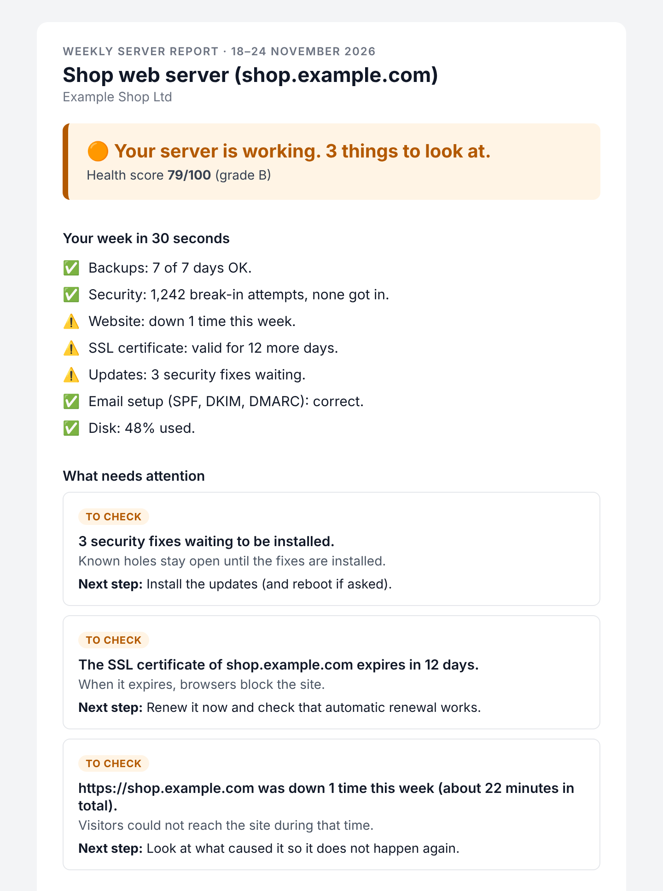

# server-report-card

**A weekly server health and security report that a business owner can actually read.**
Security, backups, website, email and disk in one email, in plain English, with an alert when something is urgent.

[](https://github.com/ahmedbmohamed/server-report-card/actions/workflows/ci.yml)


<p align="center"></p>
<p align="center"><sub>Made-up data. <a href="docs/report-full.png">Full report</a> · generate your own with <code>server-report-card demo</code></sub></p>

## Why

Most small businesses only find out something is wrong with their server **when it breaks**: the site is down, the SSL certificate expired, the disk is full, the emails go to spam, or the backup they need turns out not to work.

Monitoring tools exist (Netdata, Uptime Kuma, Zabbix…), but they are **dashboards for technicians**. Nobody at the business opens them. This tool sends one short email a week that says, in normal words:

- 🟢 **is everything OK?** and a score out of 100
- **what needs attention**, why it matters, and the next step
- the technical details at the bottom, for whoever looks after the server

and an **alert right away** when something is urgent (site down, backup failed, a new admin account, a full disk…), plus a "resolved" message when it is fixed.

## What it checks

| Area | Checks |
|---|---|
| 🔐 **Security** | SSH break-in attempts and where they come from, every successful login (alert on a **new IP** or a root login), password login / root login allowed, Fail2ban running and how many attackers it blocked, firewall on, **new accounts or new admins**, **new open ports**, databases open to the internet, pending **security updates** (and for how long), automatic updates, restart needed after a kernel update |
| 💾 **Backups** | last backup ran and is recent, **monthly automatic restore test** (restores the latest snapshot to a temp folder and compares it file by file with the live server), no backup at all = urgent |
| 🌐 **Website** | up/down and speed (every hour), **SSL certificate expiry** and trust, **domain name expiry** (RDAP) |
| ✉️ **Email** | SPF, DKIM, DMARC correct, MX present, **changes to these records** (the classic "our emails suddenly go to spam"), sending IP on spam blacklists |
| 🖥️ **Server** | disk space and inodes, memory, load, services that must run, failed services, programs killed for lack of memory, unexpected restarts, clock sync |

Everything is **read-only**: it reads logs and system state and never changes your server.

## Install (one command)

On the server, as root (RHEL/Rocky/Alma 8+, Ubuntu 20.04+, Debian 11+):

```bash
git clone https://github.com/ahmedbmohamed/server-report-card.git
cd server-report-card
sudo ./install.sh
sudo nano /etc/server-report-card/config.ini   # your website, your email domain, where to send the report
sudo server-report-card test-notify             # check the email / Telegram settings
sudo server-report-card report --send           # send a first report now
```

**Requirements: Python 3.6+ only.** No pip packages, no agent, no database, no open port. Data stays on the server (`/var/lib/server-report-card`).

What gets installed:

| Timer | When | What |
|---|---|---|
| `server-report-card-collect` | every day 06:15 | runs every check, saves the day's results |
| `server-report-card-alerts` | every hour | website, backups, disk, services → alert on new urgent problems |
| `server-report-card-report` | Monday 08:00 | builds and sends the weekly report |
| `server-report-card-restore-test` | 1st of the month | restore test of the latest backup |

Remove everything: `sudo ./install.sh --uninstall` (your config and data are kept).

### Many servers: Ansible

```bash
cd ansible
cp inventory/hosts.example.yml inventory/hosts.yml   # your servers and settings
ansible-playbook site.yml --ask-vault-pass
```

The role `report_card` installs the same files, writes the config from variables (`report_card_*`, see [defaults](ansible/roles/report_card/defaults/main.yml)) and sends a first report if `report_card_send_first_report: true`.

## Commands

```text
server-report-card check [area…]   run the checks now and print them (changes nothing)
server-report-card collect         run every check and save today's results
server-report-card alerts          fast checks, alert on new urgent problems
server-report-card report [--send] [--out file.html] [--days 7]
server-report-card restore-test    restore the latest backup into a temp folder and compare
server-report-card test-notify     send a test message on every enabled channel
server-report-card demo            write a sample report with made-up data
```

## Sending: email and Telegram

- **Email**: any SMTP server (Gmail/Google Workspace with an app password, Microsoft 365, Brevo, Mailgun, your own Postfix…). HTML report + plain-text version.
- **Telegram**: a short version of the report and the alerts on your phone. Create a bot with @BotFather and put the token and chat id in the config.

## Backups

Backups made with [linux-server-setup-kit](https://github.com/ahmedbmohamed/linux-server-setup-kit) (restic) are found automatically. Any other restic repository: put its environment file in `restic_env_files`. Any other backup tool: make it `touch` a file after each good run and put that file in `marker_files`.

The **restore test** only works with restic: it restores one folder (`/etc` by default) into a temporary directory, compares every file that did not change since the snapshot, and deletes the copy.

## For freelancers and IT providers

Put your name in `provider_name`: every report ends with *"Your server is looked after by …"*. Your client sees every week that someone is watching their server, and you see problems before they call you. That makes it easy to offer a **monthly maintenance plan**.

## How it works

```
 every hour ──► alerts ──────────────┐            urgent problem ─► email / Telegram now
 every day  ──► collect ──► snapshots/YYYY-MM-DD.json + state.json (baselines: users, ports, logins, DNS)
 Monday     ──► report  ──► 7 snapshots + events ─► score, headline, findings ─► HTML email + Telegram text
```

Each check returns findings with a status (ok / info / to check / urgent), one sentence for the owner, why it matters, the next step, and the technical detail. The score starts at 100: −20 per urgent problem, −7 per thing to check.

## Development

```bash
python3 -m pytest -q          # unit tests, no root needed
ruff check .
python3 -m reportcard demo    # sample report: demo-report.html
```

CI runs the tests on Python 3.6 (Rocky Linux 8), 3.9 (Rocky Linux 9), 3.10 (Ubuntu 22.04) and 3.12 (Ubuntu 24.04), plus a live `check` and `collect` inside each container.

## License

MIT © Ahmed Benmohamed
